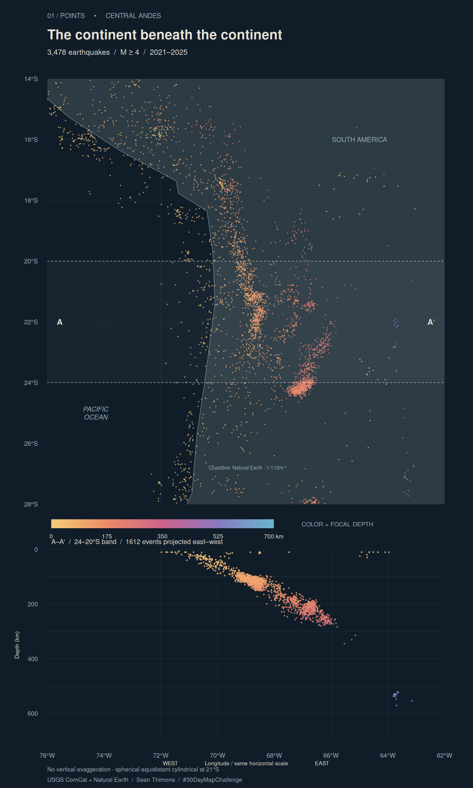

```{r}
#| label: build-andes
#| message: false
#| warning: false
local({
  old <- setwd("../..")
  on.exit(setwd(old))
  source("posts/2026-11-01-30daymap-01-points/render-map.R")
  render_day01()
})
```

```{r}
#| label: map
#| echo: false
#| fig-alt: "A dark map distinguishes slate-colored South American land from the darker blue Pacific Ocean and shows earthquake points colored from gold at shallow depths to purple and blue at greater depths. A highlighted band from 24 to 20 degrees south selects the points in the depth section below. In that section, a dense ribbon descends eastward to roughly 300 kilometers, with a separate group beyond 500 kilometers farther east. Coastline and longitude grid align the two views."

```

## The continent beneath the continent

What can a collection of points tell us about something we cannot see? For Day 1's Points theme, I mapped 3,478 earthquakes of magnitude 4 or greater recorded in the central Andes during 2021–2025. Each dot marks one event. Color gives its focal depth: gold near the surface, shifting through coral and purple toward blue at greater depths. The map asks whether those locations can make an underground structure legible.

The [Nazca plate descends beneath South America](https://pubs.usgs.gov/gip/dynamic/understanding.html). A surface map compresses that vertical story into color. The lower panel opens it up: 1,612 events between 24°S and 20°S are projected east–west and plotted at their cataloged depths. A dense, sloping ribbon reaches roughly 300 km; a smaller, separate group lies below 500 km farther east. I have left the intervening space empty. Joining the clusters with an invented plate outline would claim more than these points establish.

## Method and cartographic decisions

The package experiment is deliberately lean: base R graphics constructs the entire composition, `jsonlite` reads the reference coastline and land polygons, and `digest` checks source fingerprints. No live basemap or network request is needed during the Quarto render. The [complete R source](render-map.R) handles acquisition, validation, projection, and export.

Both panels share the same horizontal coordinates. The surface map uses a spherical equidistant cylindrical projection with a standard parallel of 21°S and a 76°W origin. Longitude becomes kilometers using a mean Earth radius of 6,371.0088 km. The lower panel uses that same horizontal distance and depth in kilometers, with **no vertical exaggeration**. It is a broad-band projection, not a thin geological slice: events across four degrees of latitude are collapsed onto one view, and local slab geometry can vary within that band.

All points have the same size. Magnitude determines inclusion, while depth controls a continuous color scale fixed at 0–700 km. A muted slate land fill separates South America from the darker blue Pacific Ocean, with a fine coastline defining the edge. Both sit beneath the earthquake points. The dashed band boundaries show exactly which events enter the section. Country borders and a fitted slab surface are omitted so the observations carry the image.

## Data & provenance

Earthquake locations, depths, and preferred magnitudes come from the [USGS ComCat event service](https://earthquake.usgs.gov/fdsnws/event/1/). The fixed query covers 76–62°W, 28–14°S, the full UTC years 2021–2025, magnitude ≥4, and depths from 0 to 700 km. The snapshot was retrieved November 4, 2026; the post's November 1 date identifies its challenge day. Input coordinates are longitude and latitude in WGS84. Depth is the catalog value, not distance below a local terrain surface.

This is a selected catalog, not a complete census or a hazard forecast. Detection and reporting vary, preferred magnitudes use different magnitude types, and locations and depths have uncertainties. USGS may revise historical events. The committed [source snapshot](source-snapshot.json) records query URLs, retrieval times, and SHA-256 fingerprints; changed inputs require deliberate review.

The coastline and land polygons are [Natural Earth](https://www.naturalearthdata.com/about/terms-of-use/) at 1:110 million scale, pinned to a repository revision. Natural Earth data are public domain; USGS-produced data are covered by its [public-domain policy and credit guidance](https://www.usgs.gov/information-policies-and-instructions/copyrights-and-credits). Credit: U.S. Geological Survey and Natural Earth.

## What I learned

The section makes the spatial argument clearer than color alone. Keeping equal distance scales also preserves how shallow the descending ribbon looks relative to the width of the continent. The point pattern supplies structure without requiring a continuous surface to be drawn around it.
