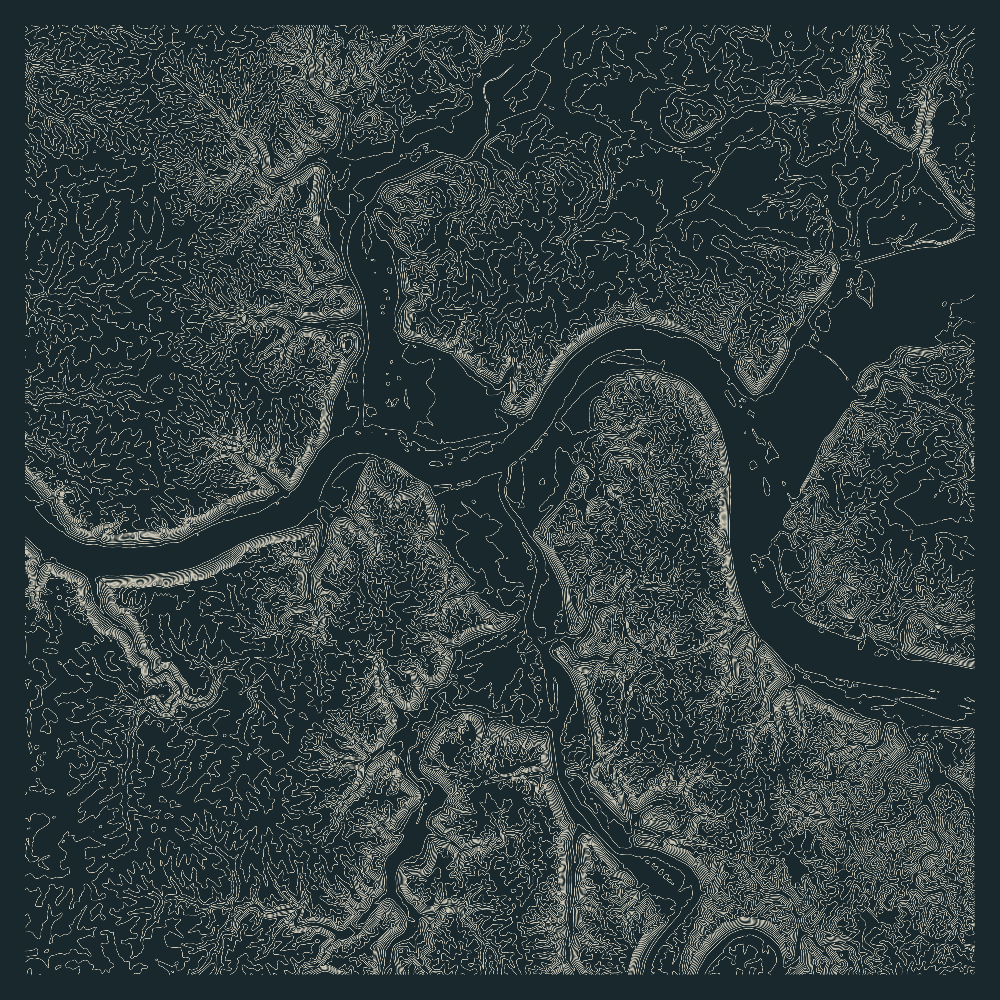

```{r}
#| label: build-terrain
#| message: false
#| warning: false
local({
  old <- setwd("../..")
  on.exit(setwd(old))
  source("posts/2026-11-02-30daymap-02-lines/render-map.R")
  render_day02(
    cache_dir = "data/30daymap/2026/day02",
    output_dir = "posts/2026-11-02-30daymap-02-lines/artifacts"
  )
})
```

```{r}
#| label: map
#| echo: false
#| fig-alt: "Pale mineral-colored elevation contours on a dark blue-green square. Closely spaced lines trace steep hills and branching valleys around a broad, winding low corridor. No streets, place labels, borders, or separate water fill appear."

```

**Can you place it from the terrain alone?**

For the Lines theme, I wanted the contours to carry the whole image. No roads to orient the eye, no neighborhood names, and no locator inset giving away the answer. The broad quiet corridor is the strongest clue. Follow its bends, then look at how the smaller valleys meet it.

The final crop is a 24 km square. A wider view gave the surrounding hills more space but weakened the central shape. A tighter crop made the river too obvious. This middle framing leaves enough structure to recognize the place without immediately naming it.

## The color decision

Night survey pairs pale mineral linework with a dark blue-green background. I compared it with warm paper and iron-oxide contours before choosing the darker version. The contours all use one color and one line weight. Their spacing supplies the tonal variation; elevation does not need a second color scale.

There is no separate river polygon. The quiet areas come from the elevation surface and the selected contour levels. They should not be read as precise shoreline boundaries.

## Method

The map is built entirely in R from the raw elevation tiles. `terra` crops and mosaics the inputs, reprojects them to a 20 m NAD83 / UTM zone 16N grid, and extracts contours. `sf` handles contour export and plotting geometry. Base R graphics renders the PNG and vector versions.

A 40 km processing buffer keeps edge effects outside the visible crop. A normalized Gaussian kernel, sigma 20 m, lightly smooths the display surface before contours are extracted at 10 m elevation intervals. The unsmoothed projected terrain is retained separately. This is a cartographic study, not a survey product: smoothing can move an individual contour.

The [complete R source](render-map.R) includes acquisition, input checks, terrain processing, exports, and provenance. The executable chunk above rebuilds the map from cached raw inputs during local rendering, rather than displaying a Python-derived substitute.

## Reveal and data provenance

The location is **Cincinnati and Northern Kentucky**, around the Ohio River valley. Elevation comes from the public-domain [USGS 3DEP one-third arc-second DEM collection](https://www.usgs.gov/3d-elevation-program/about-3dep-products-services). The original tiles were retrieved on November 2, 2026:

- [USGS_13_n40w085.tif](https://prd-tnm.s3.amazonaws.com/StagedProducts/Elevation/13/TIFF/current/n40w085/USGS_13_n40w085.tif)
- [USGS_13_n39w085.tif](https://prd-tnm.s3.amazonaws.com/StagedProducts/Elevation/13/TIFF/current/n39w085/USGS_13_n39w085.tif)

The source's roughly 10 m horizontal grid spacing is separate from our 10 m contour interval. Elevations are meters referenced to NAVD88. Reprojection changes the horizontal coordinates only; no vertical datum transformation is applied.

USGS `current` endpoints are mutable. The repository records the original SHA-256 fingerprints, while each R run records local input fingerprints, byte sizes, parameters, and session details. Large rasters and package libraries remain ignored; the download recipe and compact map exports are tracked. See the [runtime and reproduction guide](https://github.com/seanthimons/seanthimons.github.io/blob/feat/30daymap-days-01-03/tasks/30daymap-r-runtime.md) for setup and render commands.
