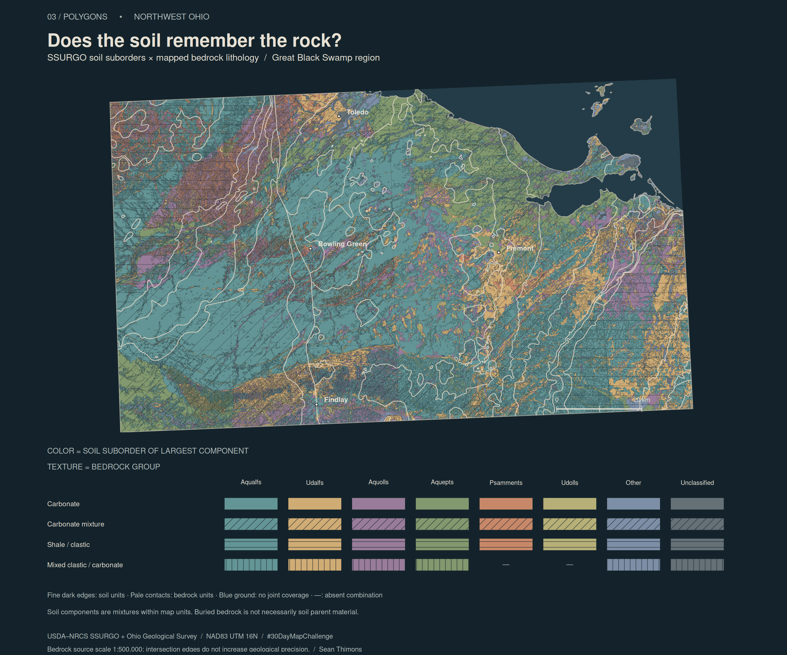

```{r}
#| label: build-soil-rock
#| message: false
#| warning: false
local({
  old <- setwd("../..")
  on.exit(setwd(old))
  source("posts/2026-11-03-30daymap-03-polygons/render-map.R")
  render_day03()
})
```

```{r}
#| label: map
#| echo: false
#| fig-alt: "A stained-glass mosaic of northwest Ohio soil polygons, colored by the taxonomic suborder of each map unit's largest soil component. Coarser bedrock contacts cross the small colored pieces. Diagonal, horizontal, and vertical textures distinguish mixed and clastic bedrock groups; carbonate units have no hatch. A matrix legend shows the color and texture combinations; dashes mark combinations absent from the study window."

```

## Does the soil remember the rock?

Soil type against rock type sounds like a natural pairing. For Day 3's Polygons theme, I wanted to see what happens when those two maps occupy the same space. The study window crosses the former Great Black Swamp region and its surroundings in northwest Ohio. It is a rectangular regional sample, not a reconstruction of the swamp's historical boundary.

The small colored pieces are soil map units, split wherever a mapped bedrock contact crosses them. Color describes soil taxonomy; texture describes the bedrock group below. Neither variable has a low-to-high ordering, so the palette works like stained glass rather than a sequential heatmap. The pale geological contacts and fine dark soil edges let the two scales remain visible. Dashes in the legend mark combinations absent from this window.

Aqualfs supply the broad turquoise areas, but that color continues across different bedrock groups. Conversely, a single rock group contains many soil-colored pieces. At these classification levels, the two mosaics do not simply trace one another.

This pairing is a question about spatial association, not an assumption that soil formed directly from the rock beneath it. Ohio's [glacial history](https://ohiodnr.gov/discover-and-learn/safety-conservation/about-odnr/geologic-survey/bedrock-geology/bedrock-geologic-history) includes transported deposits over bedrock. Those intervening materials are part of the explanation for why soil and rock boundaries need not coincide. The overlay alone cannot identify parent material or establish a causal relationship.

## What counts as a soil type?

[SSURGO](https://www.nrcs.usda.gov/resources/data-and-reports/soil-survey-geographic-database-ssurgo) map units contain components whose locations are not individually delineated. I assign each map unit the reported **taxonomic suborder of its largest component**, selected by representative component percentage (`comppct_r`). Ties go to the lowest numeric component key. That is a cartographic summary of a mixture, not a claim that every point in the polygon has the same soil.

Six named suborders receive distinct colors: Aqualfs, Udalfs, Aquolls, Aquepts, Psamments, and Udolls. Remaining reported suborders share an “Other” color; missing taxonomy and nonsoil areas have a separate gray. These are taxonomic classes, not surface-texture classes or measurements of current moisture. The source component names and percentages remain attached to the derived geometry for inspection.

## Method

All acquisition, classification, intersections, and graphics run in R. `httr` retrieves paginated soil geometry and component records from [NRCS Soil Data Access](https://sdmdataaccess.sc.egov.usda.gov/). `sf` transforms both sources to NAD83 / UTM zone 16N (EPSG:26916), repairs invalid geometry where necessary, clips the study window, and computes the intersections. Base R graphics draws the polygon fills, contacts, and clipped hatch lines.

The [bedrock layer](https://gis2.ohiodnr.gov/arcgis/rest/services/DNR_Services/SUBSURFACE/MapServer/5) comes from the Ohio Geological Survey's generalized **1:500,000-scale** map. Its lithology descriptions are grouped explicitly in [rock-groups.csv](rock-groups.csv). Carbonate units are unhatched; carbonate mixtures are diagonal; shale/clastic units are horizontal; mixed clastic/carbonate units are vertical. Intersecting this source with detailed soils creates smaller pieces, not more precise geology. Thin slivers may reflect differences in source scale and boundary placement.

## Data & provenance

The study window is 84.2–82.6°W and 41.0–41.7°N. Both sources were retrieved November 4, 2026; the November 3 post date identifies the challenge day. Source services return longitude/latitude coordinates in WGS84. No downloads occur during the post render.

The [source snapshot](source-snapshot.json) records SHA-256 fingerprints and retrieval times. Services can revise their data, so exact reproduction requires retaining the ignored raw cache. The [complete R pipeline](render-map.R), [acquisition recipe](acquire-data.R), and [intersection-area table](artifacts/intersection-area-km2.csv) accompany the map. Blue ground marks areas without joint source coverage; it is not a soil class.

Credit: USDA Natural Resources Conservation Service and the Ohio Department of Natural Resources, Division of Geological Survey. Sources are publicly accessible government datasets; consult their linked metadata and use guidance. See the repository's runtime guide for setup and reproduction commands.
