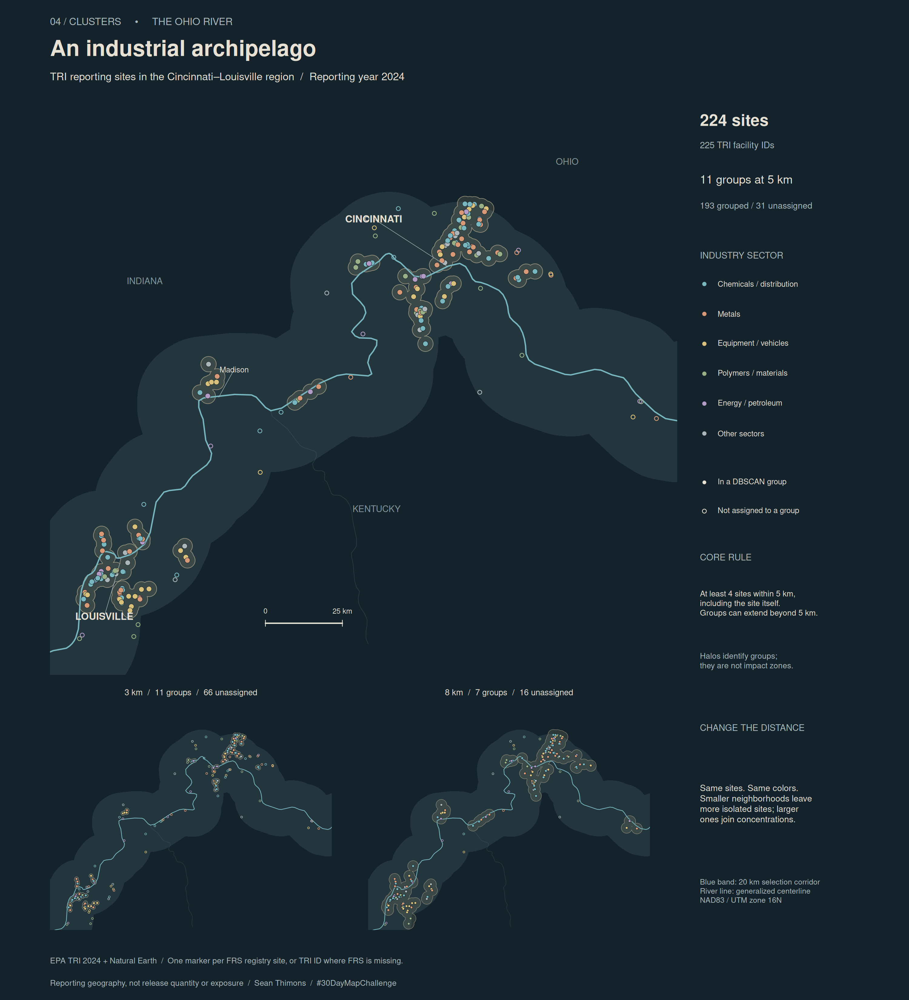

```{r}
#| label: build-industrial-archipelago
#| include: false
#| message: false
#| warning: false
local({
  old <- setwd("../..")
  on.exit(setwd(old))
  source("posts/2026-11-04-30daymap-04-clusters/render-map.R")
  render_day04()
})
```

```{r}
#| label: map
#| echo: false
#| fig-alt: "A dark map of the Ohio River in the Cincinnati–Louisville region shows 224 reporting sites colored by broad industry sector. Filled markers and pale halos identify density-based groups, concentrated near the two cities with smaller groups between them. Open markers indicate unassigned sites. Two smaller maps compare 3 and 8 kilometer neighborhoods with the main map's 5 kilometer setting."

```

## An industrial archipelago

Where do reporting industrial sites gather along the Ohio River, and how much does the answer depend on what we call a neighborhood? For Day 4's Clusters theme, I mapped locations in the Cincinnati–Louisville region from EPA's 2024 Toxics Release Inventory. The river provides a geographic spine, with concentrations near the two cities and smaller groups between them.

The main map contains **224 sites representing 225 TRI facility IDs**. Equal-sized markers show location, with color identifying broad industry sectors. Filled markers belong to a density-based group; open markers remain unassigned at the chosen distance. The blue band marks the 20 km selection corridor around the thin river line. Pale halos gather grouped sites into an archipelago. Those halos are display buffers, not release, exposure, or impact boundaries.

## Count places before finding clusters

A TRI Basic Data row is a chemical reporting record, so counting rows would give some facilities many votes. The Ohio, Kentucky, and Indiana files contain 9,718 rows and 2,559 distinct TRI IDs. I first collapse repeated chemical records by TRI ID, checking that identity and coordinates agree. I then combine IDs sharing an EPA Facility Registry Service identifier and location. Missing FRS identifiers retain their TRI IDs as separate keys.

Two visible TRI IDs share one registry location, so that location contributes one point to clustering. The [site export](artifacts/reporting-sites.csv) retains the contributing IDs and names. An explicit [sector crosswalk](sector-groups.csv) groups EPA's industry labels; sites spanning different groups use “Other sectors.” Marker size does not encode chemical quantities.

## How the islands are defined

The package experiment is `dbscan`. A core site needs at least four sites, including itself, within 5 km. Nearby border sites can join a core site's group, and connected neighborhoods can make a group much wider than 5 km. Groups describe this algorithm's result, not statistically significant industrial hotspots.

At 5 km, **193 visible sites form 11 groups**, leaving 31 unassigned. A 3 km neighborhood also yields 11 groups but includes only 158 sites; the equal group counts do not establish identical membership. At 8 km, 208 sites join seven groups. The smaller panels keep the sites and sector colors fixed while changing distance.

The study selects sites within 20 km of the mapped Ohio River centerline. Clustering uses all 354 qualifying sites in the three-state dataset before cropping to the displayed window, reducing truncation at the picture's edges. `sf` projects coordinates into NAD83 / UTM zone 16N (EPSG:26916) for distance calculations. The [complete native R pipeline](render-map.R) handles acquisition, deduplication, clustering, exports, and graphics.

## Data & provenance

EPA's [TRI Basic Data Files](https://www.epa.gov/toxics-release-inventory-tri-program/tri-basic-data-files-calendar-years-1987-present) supply reporting year 2024 records. EPA's [field guide](https://www.epa.gov/system/files/documents/2025-09/basic_data_files_documentation_august_2024.pdf) identifies the coordinates as FRS locations. The snapshot's datum fields are blank; this map explicitly assumes WGS84 for those coordinates. That assumption and source location uncertainty limit precision near distance thresholds.

The river is a generalized [Natural Earth](https://www.naturalearthdata.com/downloads/10m-physical-vectors/10m-rivers-lake-centerlines/) centerline, pinned to a repository revision. The 20 km selection is relative to that mapped line. The display window is 86–83.7°W and 38–39.5°N. Data were retrieved November 4, 2026; [source fingerprints](source-snapshot.json) identify the cached payloads. Rendering makes no network requests.

Credit: U.S. Environmental Protection Agency and Natural Earth. Natural Earth data are public domain; EPA data are publicly downloadable under the linked program guidance. TRI covers specified reporting facilities and chemicals, [not all industrial activity](https://www.epa.gov/trinationalanalysis/tri-data-considerations). These are reporting locations, not a map of pollutant transport or health risk.
