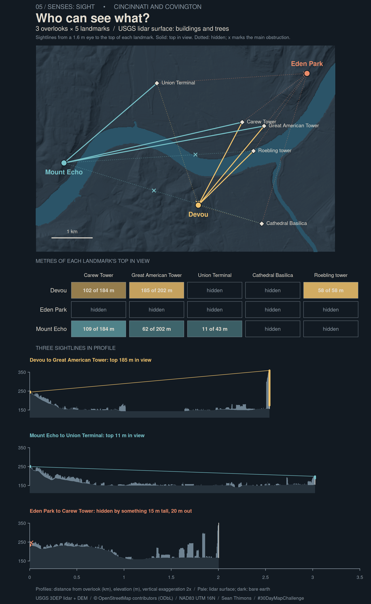

```{r}
#| label: build-sightlines
#| include: false
#| message: false
#| warning: false
local({
  old <- setwd("../..")
  on.exit(setwd(old))
  source("posts/2026-11-05-30daymap-05-senses-sight/render-map.R")
  render_day05()
})
```

```{r}
#| label: map
#| echo: false
#| fig-alt: "A dark shaded-relief map of Cincinnati and Covington with the Ohio River in blue. Fifteen sightlines run from three overlooks (Devou, Eden Park and Mount Echo) to five landmarks. Solid lines reach Carew Tower, Great American Tower and the Roebling Bridge tower from Devou, and Carew Tower, Great American Tower and Union Terminal from Mount Echo. Every line from Eden Park, and every line to the Cathedral Basilica, is dotted. A grid below lists how many metres of each landmark's top are in view. Three elevation profiles show Devou's clear line to Great American Tower, Mount Echo's view of Union Terminal's dome just clearing the rooftops, and Eden Park's line stopped by trees 20 metres out."

```

## Who can see what?

For Day 5's Sight theme, I asked which landmarks you can actually see from three hillside overlooks: Devou Memorial Overlook in Covington, Eden Park, and Mount Echo Park in Price Hill. The targets are Carew Tower, Great American Tower, Union Terminal, Covington's Cathedral Basilica, and the Roebling Bridge's north tower. For each of the 15 pairs, the map measures how much of the landmark's top rises above everything in between.

**Devou** has the best seat. It sees 185 m of Great American Tower's 202 m, the top 102 m of Carew Tower, and the whole Roebling tower. **Mount Echo** sees the top 109 m of Carew, 62 m of Great American Tower, and the top 11 m of Union Terminal's dome. It is the only overlook that sees the terminal. A building about 137 m tall, 300 m short of Great American Tower, hides most of that tower from Mount Echo.

From the **Eden Park** viewpoint, nothing on the list is visible. Returns 15 to 24 m above the ground, almost certainly park trees, stand 20 to 50 m away toward every target. The **Cathedral Basilica**, at 37 m, is hidden from all three.

On bare earth alone, 11 of the 15 pairs would see at least part of their landmark. With buildings and trees, 6 do. Eden Park would see the top 124 m of Carew Tower, and Devou would see all five landmarks.

## Method

The package experiment is [`rlas`](https://cran.r-project.org/package=rlas), which reads compressed lidar. The [acquisition script](acquire-lidar.R) downloads only the point-cloud pieces that touch the sightlines and landmark outlines, then reduces them to small committed tables. For every metre along each sightline, it keeps the highest return within 1.5 m of the line. Each landmark's top is the 99.9th percentile of the returns inside its OpenStreetMap outline. The Roebling tower is located from the lidar instead: the two highest points on the bridge are 323 m apart, matching its 322 m main span.

The [map script](render-map.R) uses `terra` and base R graphics in NAD83 / UTM zone 16N. The eye is 1.6 m above the ground at each overlook. Every surface point between eye and landmark sets a floor: the landmark is visible only above the ray from the eye over that point. The metres in view are the landmark's top minus the highest such floor, with Earth curvature and standard refraction (k = 0.13). Missing returns, mostly over water, fall back to the bare-earth DEM.

Two exclusions keep it fair. The first 15 m around the observer are cleared, since a viewpoint is a gap in the trees, and the landmark's own outline plus 5 m is ignored, because a tower does not block itself. Clearing 30 m instead changes nothing, nor does a 10 m buffer. A 3 m buffer lets Carew Tower's own edge, just outside its OSM outline, hide most of it. The [sightline matrix](artifacts/sightline-matrix.csv) lists every pair with those variants, the main obstruction, and lidar coverage, which is at least 97.8% on every line. A [test script](https://github.com/seanthimons/seanthimons.github.io/blob/master/tests/test-day05-map.R) checks the calculation against hand-worked cases.

## Data & provenance

Lidar is from the USGS 3D Elevation Program: Ohio's 2021 statewide collection (work unit `OH_StatewideP3_6_B21`) and the `KY_Western_1_A22` Kentucky collection, read from the public Entwine copies on AWS Open Data and retrieved November 10–11, 2026. Lidar ground matches the bare-earth DEM to a median 5 cm. Most returns are unclassified, so the map cannot say whether an obstruction is a roof or a tree. If the collections were flown leaf-off, as statewide programs often are, summer canopy would block more.

Bare earth is the 3DEP one-third arc-second tile [USGS_13_n40w085.tif](https://prd-tnm.s3.amazonaws.com/StagedProducts/Elevation/13/TIFF/current/n40w085/USGS_13_n40w085.tif), byte-for-byte the file used on [Day 2](../2026-11-02-30daymap-02-lines/2026-11-02-30daymap-02-lines.qmd). The [source snapshot](source-snapshot.json) fingerprints the tile and every lidar piece in [ept-nodes.csv](ept-nodes.csv). The render makes no network requests.

Overlooks are OpenStreetMap viewpoint nodes ([overlooks.csv](overlooks.csv)); landmark outlines are OSM ways ([landmarks.geojson](landmarks.geojson)). Each overlook is a single point; a few steps along a railing could change a result, Eden Park's especially. USGS data are in the [U.S. public domain](https://www.usgs.gov/information-policies-and-instructions/copyrights-and-credits). Map data © [OpenStreetMap contributors](https://www.openstreetmap.org/copyright), available under the Open Database License.

## What I learned

The land promises more than the city delivers. Bare earth gave Eden Park downtown's towers; the lidar closes that view within 50 m. Devou wins because its views fall steeply over Covington's low rooftops and the open river.
