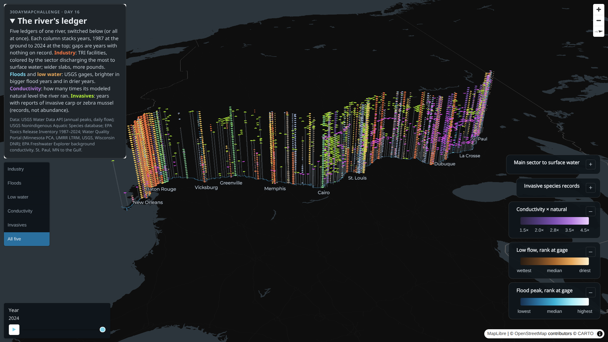

```{r}
#| label: build-river-ledger
#| include: false
#| message: false
#| warning: false
day16_map <- local({
  old <- setwd("../..")
  on.exit(setwd(old))
  source("posts/2026-11-16-30daymap-16-collaborative-map/render-map.R", local = TRUE)
  render_day16()
})
```

```{r}
#| label: map
#| echo: false
#| column: page
#| fig-height: 7.5
day16_map
```

::: {.callout-note collapse="true"}
## Static version and alt text

{fig-alt="A dark 3D map seen from the east at a steep angle, with the Mississippi running left to right from New Orleans past Baton Rouge, Vicksburg, Greenville, Memphis, Cairo, St. Louis, Dubuque and La Crosse to St. Paul. Hundreds of thin columns of stacked slabs rise from the river, one slab per year from 1987 at the ground to 2024 at the top, in all five ledgers at once: orange and other sector colors for industry, blue for floods, tan for low water, purple for conductivity, and lime and magenta for invasive carp and zebra mussel. The densest orange columns stand between Baton Rouge and New Orleans. Thin grey stems tie columns that start late to the ground. A description panel and a layer switch sit at the left, a year slider at the bottom left, and legends at the right."}
:::

## Five ledgers of one river

Day 16's theme is Collaborative map, so a friend and I made it a head-to-head. Same river, the Mississippi from St. Paul to the Gulf, and only USGS and EPA data. Best map wins. My friend went after what the water carries: chloride, nitrate, phosphorus and sediment. I went after the record the river keeps, borrowing the space-time cube Kyle Walker built for Day 10. Each place along the river gets a column, and each year from 1987 to 2024 is one slab in it. A gap is a year with nothing on record.

The switch on the left shows one ledger at a time, or all five at once:

- **Industry.** EPA Toxics Release Inventory discharges to surface water from 1,724 facilities within 10 km of the river, binned to 12 km hexagons. Slab width follows pounds on a log scale, and color is the sector discharging the most. Reported discharges in the corridor fall from 581 million lb in 1987 to 12 million in 2024. Sodium sulfate and phosphoric acid dominate the early years, nitrate compounds the recent ones.
- **Floods.** The annual peak at 12 USGS gages, ranked against that gage's own 1987–2024 peaks. 2001 tops six upper-river gages, from St. Paul to Clinton, Iowa. 1993 tops three around St. Louis.
- **Low water.** The lowest 7-day mean flow of each climatic year (April to March) at 10 gages from St. Paul to Thebes, Illinois. 1988 is the driest year at five of them, and 1989 at three.
- **Conductivity.** The median specific conductance each water year at 19 main-stem columns (one organization's sites within 15 km are pooled), divided by EPA's modeled natural background for that reach. The river ran at 1.5 to 4.4 times its natural level.
- **Invasives.** Years with USGS Nonindigenous Aquatic Species records of invasive carp (silver, bighead, black) or zebra mussel. Zebra mussel reports reach most of the corridor between 1991 and 1993. Carp records arrive from the south and are first reported above the Quad Cities in 2002.

Hover a slab for its numbers. Press play to watch the columns grow. Columns that start after 1987 stand on a thin grey stem, so a late slab stays tied to its place.

## Method

The cube is a `mapgl` MapLibre map. Every site-year is a `fill-extrusion` polygon whose base and top are counted in years and multiplied by a zoom-dependent height. One year is 16 km tall at zoom 4 and 60 m at zoom 12, so the columns stay readable at any scale. The year slider filters on each slab's year, and `add_layers_control()` swaps ledgers one at a time. In "All five", each ledger takes its own plate within the year. Floods and low water share a gage, so each takes half of the disc. No two surfaces overlap.

The key design choice is to rank floods and low water within each gage rather than map flow in cfs. Flow at Thebes is more than ten times flow at St. Paul, so raw numbers would only show where the river is big. Ranks show which years were extreme for that place. Gages with fewer than 25 years of peaks or of complete low-flow years in 1987–2024 are left out, which leaves Vicksburg as the last flood gage and a gap below Thebes for low water. The gages below the Old River Control Structure, where the flow is split with the Atchafalaya, do not meet that rule.

Distances, the 10 km corridor and the hexagons are computed in `sf` in CONUS Albers (EPSG:5070); the map draws in Web Mercator. Conductivity uses one value per site visit and needs at least six visits in a water year. Invasive species records need accurate or approximate coordinates and are dropped when the database marks them as failed, eradicated, extirpated or stocked. The [complete R pipeline](render-map.R) handles acquisition, reduction and the widget.

## Data & provenance

- **EPA [Toxics Release Inventory](https://www.epa.gov/toxics-release-inventory-tri-program/tri-basic-data-files-calendar-years-1987-present)** basic data files, 1987–2024, for ten river states. 7,615 dioxin reports in grams are left out rather than mixed with pounds.
- **USGS [Water Data API](https://api.waterdata.usgs.gov/)** annual peaks and daily mean discharge, through `dataRetrieval` 2.7.27.
- **[Water Quality Portal](https://www.waterqualitydata.us/)** specific conductance from USGS, the Upper Mississippi River Restoration program, Minnesota PCA and Wisconsin DNR. 26 results labeled in other units are dropped.
- **EPA [Freshwater Explorer](https://www.epa.gov/water-research/freshwater-explorer)** predicted natural background conductivity on NHDPlus V2 reaches.
- **USGS [Nonindigenous Aquatic Species](https://nas.er.usgs.gov/)** database occurrence records.
- **[Natural Earth](https://www.naturalearthdata.com/)** river centerline, pinned to a repository revision. Basemap © CARTO and OpenStreetMap contributors.

Sources were retrieved November 17–18, 2026. [Source fingerprints](source-snapshot.json) identify the cached files and committed tables; the render stops if a cached file changed. Rendering makes no data requests; only the basemap tiles load live. Coordinates are WGS84. Federal data are public domain, and Natural Earth is public domain.

## Caveats

- TRI covers listed chemicals above reporting thresholds, and EPA has added and dropped chemicals since 1987. The long decline mixes real cuts with changes in what had to be reported.
- Invasive species records reflect where people looked and reported, not how many animals there are.
- The background conductivity is modeled: a random forest prediction of the 2000–2015 average with minimal human influence. Each site is matched to its nearest modeled Mississippi reach, and that one value is used for every year.
- These are records, not risk: the map does not show pollutant transport, exposure or health effects.
